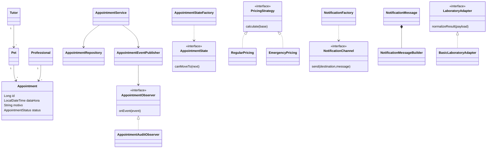
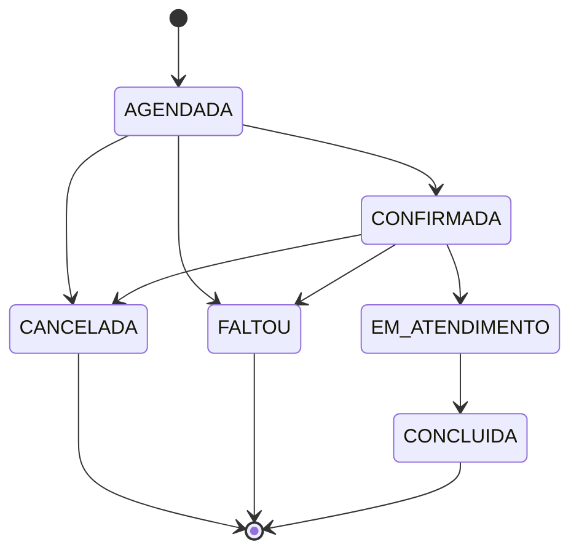
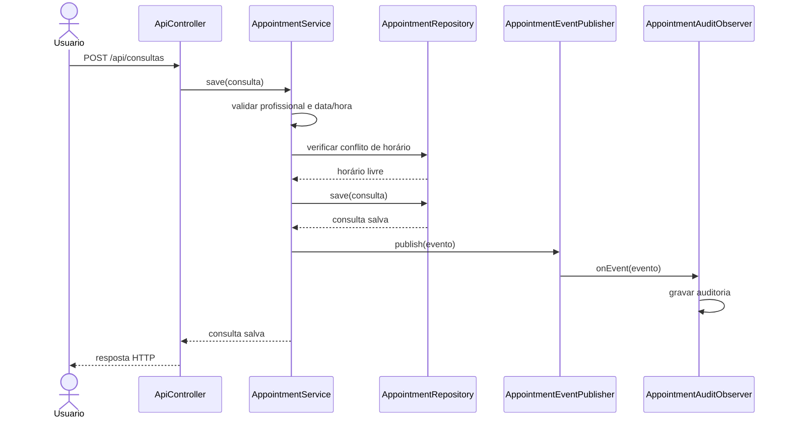
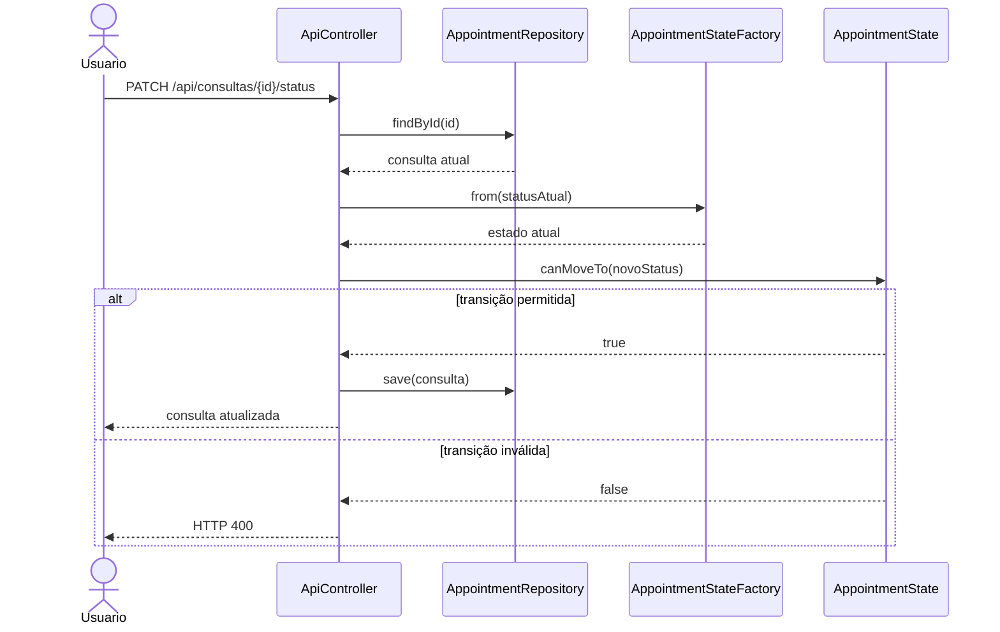
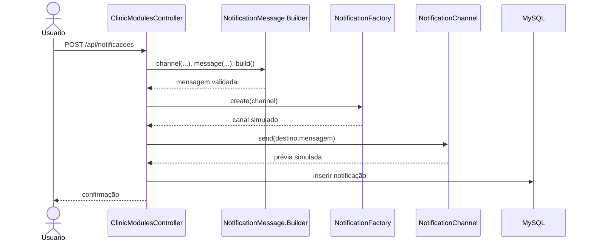

# Diagramas UML — VETCARE 3D

Os diagramas representam a estrutura e os fluxos identificados no código. Mermaid é renderizado pelo GitHub em Markdown.

## Diagrama de classes

## Ciclo de vida de consulta

## Sequência — agendar consulta

## Sequência — alterar status

## Sequência — notificação simulada

## Observação
O requisito de múltiplos tutores por animal não está demonstrado no modelo JPA consultado; tratar como limitação até implementação e validação.
